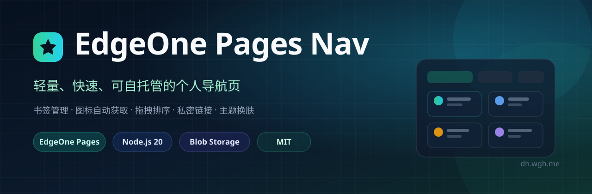
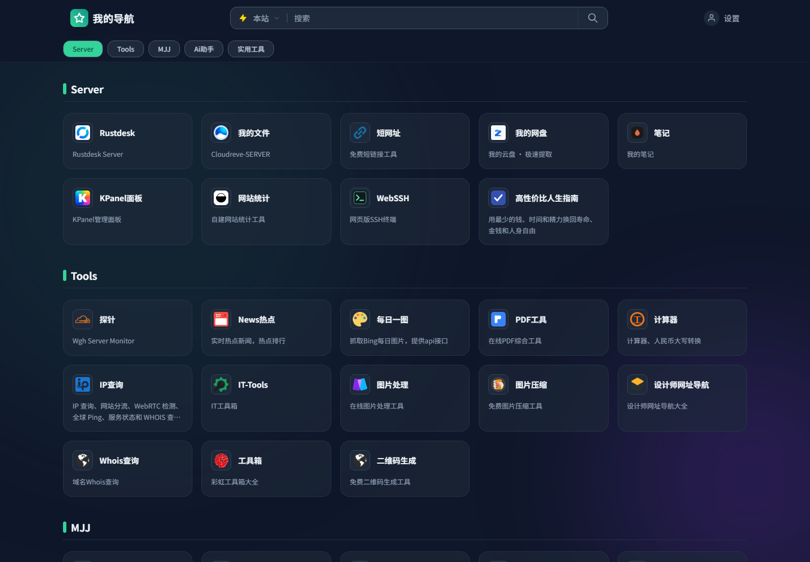
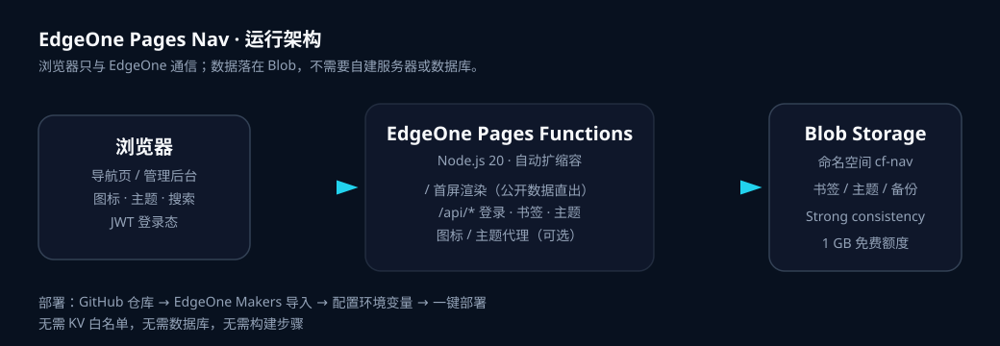

<div align="center">
  
  <p>使用 EdgeOne Pages 搭建的轻量化导航页面。集成书签管理、图标自动获取、拖拽排序、私密链接保护、主题换肤等功能。</p>
  <p>
    <a href="https://dh.wgh.me"><strong>🌐 在线演示</strong></a>
    &nbsp;·&nbsp;
    <a href="https://github.com/wgh208/EdgeOne-Pages-Nav"><strong>GitHub</strong></a>
    &nbsp;·&nbsp;
    <a href="#一键部署"><strong>🚀 一键部署</strong></a>
    &nbsp;·&nbsp;
    <a href="#功能特性"><strong>✨ 功能特性</strong></a>
    &nbsp;·&nbsp;
    <a href="#本地开发"><strong>🛠 本地开发</strong></a>
  </p>
  <p>
    
    
    
    
    
  </p>
</div>

> **演示站点：** <https://dh.wgh.me>  
> **存储方式：** EdgeOne Blob（自动创建命名空间，无需申请 KV）  
> **运行方式：** EdgeOne Pages Functions · Node.js 20

---

## 📖 项目简介

**EdgeOne Pages Nav** 是一个可以完全托管在腾讯云 EdgeOne Pages 上的个人导航页。它把书签、分类、主题和登录状态都收进一个轻量的全栈项目里，不需要购买服务器、不需要数据库，也不需要单独维护后端。

项目使用 **Node.js 20 Cloud Functions** 提供页面与 API，使用 **EdgeOne Blob** 持久化数据。首次写入时会自动创建名为 `cf-nav` 的 Blob 命名空间，因此没有 KV 白名单也可以直接部署。

前端采用单文件 HTML + 内联 CSS/JS，打开即用；管理端支持在线增删改、拖拽排序、导入 Chrome/Edge 书签、发布全局主题和自动备份。

<p align="center">
  
</p>

---

## 功能特性

### 内容管理

- **书签管理**：新增、编辑、删除、分类归档，支持自定义图标和描述。
- **拖拽排序**：PC 端鼠标拖拽、移动端长按拖拽，分类和卡片都可以调整顺序。
- **分类视图**：分类快捷栏、隐藏分类、分类内搜索，适合书签较多的场景。
- **导入导出**：支持 Chrome / Edge 导出的 HTML 书签，以及本站 JSON 配置。
- **自动备份**：每次保存前按 10 分钟节流备份，最多保留 10 份历史数据。

### 图标与搜索

- **图标自动获取**：默认直接调用图标 API，失败时回退到默认图标；也可以切换为服务端代理模式。
- **聚合搜索**：站内搜索 + Google / Bing / 百度，支持快捷键和搜索词联想。
- **响应式布局**：卡片视图与 APP 视图自由切换，适配桌面和手机。

### 主题与外观

- **主题换肤**：内置多套主题，支持 tweakcn 社区主题。
- **全局主题**：管理员切换主题后可以发布给所有访客；普通访客的换肤只保存在本地。
- **深色模式**：手动切换或跟随系统。
- **主题导入导出**：支持 JSON 文件 / 文本导入，带结构校验和 CSS 值消毒。

### 安全

- **私密链接**：标记为私密的书签只对登录管理员可见，公开接口会在服务端过滤。
- **JWT 登录**：Access Token + HttpOnly Refresh Cookie，支持自动续期和主动吊销。
- **登录限流**：同一客户端连续输错 5 次锁定 15 分钟。
- **输入防护**：URL 协议白名单、HTML 属性转义、主题 CSS 值白名单。
- **代理防护**：图标代理会拦截内网地址和非图片响应（仅在代理模式下启用）。

### 性能

- **首屏数据直出**：公开书签在服务端直接注入 HTML，未登录访客不用等待 `/api/getLinks`。
- **图标直连 CDN**：默认不再为每个图标调用一次函数。
- **主题与数据并行读取**：减少串行等待。
- **ETag 缓存**：内容和数据变化后自动失效旧缓存。
- **无 Google Fonts 依赖**：默认使用系统中文字体，避免国内网络不可达导致的额外等待。

---

## 🏗 技术架构

<p align="center">
  
</p>

```
浏览器
  │
  ▼
EdgeOne Pages
  ├── Cloud Functions (Node.js 20)
  │     ├── /                 首屏 HTML + 公开数据直出
  │     ├── /api/login        管理员登录 / JWT
  │     ├── /api/getLinks     书签数据（公开/登录两种视图）
  │     ├── /api/saveData     保存书签
  │     ├── /api/saveTheme    发布全局主题
  │     └── /api/icon         图标代理（可选）
  │
  └── Blob Storage
        └── cf-nav            书签 / 主题 / 备份
```

- **页面与 API**：`cloud-functions/index.js`（根路径）和 `cloud-functions/[[id]].js`（其余路径）。
- **业务核心**：`lib/nav-worker.js`，包含路由、鉴权、数据校验、主题、图标、备份等逻辑。
- **存储适配**：`lib/blob-kv.js` + `lib/blob-kv-core.js`，把 Blob 包装成项目内部使用的 KV 接口。
- **数据一致性**：Blob 使用 `consistency: "strong"`，保存后立即读取即可看到最新数据。

---

## 一键部署

[](https://console.cloud.tencent.com/edgeone/makers/new?repository-url=https%3A%2F%2Fgithub.com%2Fwgh208%2FEdgeOne-Pages-Nav&project-name=EdgeOne-Pages-Nav&env=ADMIN_PASSWORD%2CJWT_SECRET)

点击按钮后会跳转到 EdgeOne Makers，并自动填入本仓库地址。创建项目时填写两个必填环境变量：

| 变量名 | 必填 | 说明 |
|---|---|---|
| `ADMIN_PASSWORD` | ✅ | 管理员登录密码，至少 8 个字符 |
| `JWT_SECRET` | ✅ | JWT 签名密钥，至少 32 个字符的随机字符串 |

部署完成后：

1. 打开 EdgeOne 分配的域名；
2. 点击右上角「登录 / 退出」，输入 `ADMIN_PASSWORD`；
3. 进入编辑模式，添加分类和书签；
4. 可选：在「设置 → 主题皮肤」里选择主题并发布。

> 不需要创建 KV、数据库或对象存储桶。Blob 命名空间 `cf-nav` 会在首次写入时自动创建。

---

## 🧭 手动部署

如果不想用一键按钮，也可以手动导入仓库：

### 1. 准备仓库

Fork 本仓库，或把代码推送到自己的 GitHub 仓库。

### 2. 创建 Makers 项目

1. 打开 [EdgeOne Makers 控制台](https://console.cloud.tencent.com/edgeone/makers)；
2. 点击「创建项目」→「导入 Git 仓库」；
3. 选择你的 `EdgeOne-Pages-Nav` 仓库和分支；
4. 框架选择「Other / 其他」，构建命令留空；
5. 输出目录保持项目根目录。

项目没有前端构建步骤，平台会自动执行 `npm install` 安装 `@edgeone/pages-blob`。

### 3. 配置环境变量

在项目设置的「环境变量」中添加：

| 变量名 | 必填 | 默认值 | 说明 |
|---|---|---|---|
| `ADMIN_PASSWORD` | ✅ | 无 | 管理员密码，至少 8 个字符 |
| `JWT_SECRET` | ✅ | 无 | JWT 签名密钥，至少 32 个字符 |
| `DEFAULT_USER` | ⬜ | `testUser` | 数据 key 前缀，也是用户标识 |
| `ALLOWED_ORIGINS` | ⬜ | 空 | 允许跨域的来源，多个用英文逗号分隔 |
| `ICON_API` | ⬜ | `https://api.xinac.net/icon/?url=` | 图标 API 前缀 |
| `PREFER_ICON_API` | ⬜ | `true` | `true` 浏览器直连图标 API；`false` 走 `/api/icon` 代理 |

### 4. 部署并绑定域名

点击部署，等待构建完成。然后可以在「域名管理」里绑定自己的域名并开启 HTTPS。

### 5. 首次使用

访问站点 → 登录 → 添加书签。已有数据可以通过「导入配置」导入本站 JSON，或直接导入 Chrome / Edge 的 HTML 书签。

---

## 本地开发

需要 Node.js 20+ 和 EdgeOne CLI：

```bash
npm install -g edgeone
git clone https://github.com/wgh208/EdgeOne-Pages-Nav.git
cd EdgeOne-Pages-Nav
npm install
edgeone login
edgeone makers link --name EdgeOne-Pages-Nav
edgeone makers dev --name EdgeOne-Pages-Nav
```

默认访问 `http://127.0.0.1:8088/`。

> Blob 在本地开发时需要先关联到 Makers 项目（`link`），否则会提示缺少 Blob 凭据；只预览页面不需要 Blob。

---

## 📁 项目结构

```
EdgeOne-Pages-Nav/
├── cloud-functions/
│   ├── index.js              # 根路径 / 的入口
│   └── [[id]].js             # 其余路径的入口（/api/* 等）
├── lib/
│   ├── nav-worker.js         # 全部业务逻辑（路由/鉴权/数据/主题/图标）
│   ├── blob-kv.js            # Blob 初始化（命名空间 cf-nav）
│   └── blob-kv-core.js       # Blob → KV 接口适配
├── assets/
│   ├── banner.svg
│   ├── architecture.svg
│   └── screenshot-desktop.png
├── package.json
├── package-lock.json
├── .env.example
├── LICENSE
└── README.md
```

---

## 🔌 API 一览

| 方法 | 路径 | 说明 |
|---|---|---|
| `GET` | `/` | 导航页 HTML（含公开数据直出） |
| `POST` | `/api/login` | 管理员登录，返回 Access Token |
| `POST` | `/api/refreshToken` | 使用 HttpOnly Cookie 续期 |
| `GET` | `/api/validateToken` | 校验登录状态 |
| `POST` | `/api/logout` | 退出并吊销 Token |
| `GET` | `/api/getLinks` | 获取书签（未登录自动过滤私密链接） |
| `POST` | `/api/saveData` | 保存书签 |
| `POST` | `/api/importData` | 导入配置 |
| `POST` | `/api/exportData` | 导出配置 |
| `POST` | `/api/backupData` | 手动备份 |
| `GET` | `/api/getTheme` | 获取已发布主题 |
| `POST` | `/api/saveTheme` | 发布全局主题 |
| `GET` | `/api/icon` | 图标代理（`PREFER_ICON_API=false` 时使用） |
| `GET` | `/api/theme-proxy` | tweakcn 主题代理 |

---

## 💾 数据与备份

数据保存在 EdgeOne Blob 的 `cf-nav` 命名空间中：

| Key | 内容 |
|---|---|
| `testUser`（或 `DEFAULT_USER`） | 书签分类与链接 JSON |
| `testUser:theme` | 已发布的全局主题 |
| `backup_testUser_*` | 自动 / 手动备份，最多保留 10 份 |
| `__backup_ts__` | 上次备份时间戳 |
| `__keygen__` | Token 吊销世代 |
| `__rev__` | 数据版本号 |

- 所有读写使用 **strong consistency**，保存后立即读取即可看到最新数据。
- 免费额度 1 GB，对个人导航站通常足够。
- 建议定期在管理端「导出配置」保存一份 JSON 到本地。

---

## ⚡ 性能说明

这版针对「打开慢」做过专门优化：

- 首页公开书签由服务端直接注入，不再等待一次 `/api/getLinks`。
- 主题与书签数据并行读取。
- 默认图标由浏览器直接请求图标 CDN，不再每张卡片调用一次函数。
- 统计脚本使用 `async`，不阻塞 `DOMContentLoaded`。
- 默认移除 Google Fonts，国内网络不会卡在不可达域名上。
- HTML 使用 ETag 校验，内容变化后自动绕过旧缓存。

> 管理员登录后仍会拉取包含私密链接的完整数据；公开直出只包含公开书签。

---

## 🔒 安全说明

- `ADMIN_PASSWORD` 和 `JWT_SECRET` 只存在于 EdgeOne 环境变量中，不会进入前端代码。
- 私密链接在服务端过滤，未登录请求不会返回。
- 登录接口按客户端 IP 限流，连续失败 5 次锁定 15 分钟。
- 主题变量经过白名单与 CSS 值消毒，避免样式注入。
- 图标 / 主题代理默认拦截内网地址，仅返回图片类型响应。
- 建议使用至少 32 位随机字符串作为 `JWT_SECRET`，并定期更换。

---

## ❓ 常见问题

<details>
<summary><strong>没有 EdgeOne KV 权限可以部署吗？</strong></summary>

可以。本项目使用 EdgeOne Blob，不需要 KV 白名单。首次写入会自动创建 `cf-nav` 命名空间。
</details>

<details>
<summary><strong>数据存在哪里？会丢吗？</strong></summary>

数据存在 EdgeOne Blob。项目会自动备份最近 10 份，仍建议定期导出 JSON 到本地。
</details>

<details>
<summary><strong>忘记管理员密码怎么办？</strong></summary>

在 EdgeOne 项目设置里修改 `ADMIN_PASSWORD` 环境变量，然后重新部署。
</details>

<details>
<summary><strong>图标不显示？</strong></summary>

先检查目标站点或 `ICON_API` 是否可访问；也可以把 `PREFER_ICON_API` 设为 `false`，改用 `/api/icon` 代理模式。
</details>

<details>
<summary><strong>部署后提示 Blob 未初始化 / 缺少 deployCredential？</strong></summary>

确认部署的是 Cloud Functions，并且 `package.json` 中的 `@edgeone/pages-blob` 已安装；本地开发需要先执行 `edgeone makers link`。
</details>

<details>
<summary><strong>如何换域名？</strong></summary>

在 Makers 项目的「域名管理」中绑定自定义域名，按提示配置 CNAME 和 HTTPS 证书即可。
</details>

---

## 🤝 贡献

欢迎提交 Issue 和 Pull Request：

1. Fork 本仓库；
2. 创建分支：`git checkout -b feature/your-feature`；
3. 提交修改并附上必要的说明；
4. 发起 Pull Request。

如果这个项目对你有帮助，欢迎点一个 ⭐ Star。

---

## 🙏 致谢

- 产品形态与早期 Cloudflare Workers 版本来自 [lineagett/cf-workers-nav](https://github.com/lineagett/cf-workers-nav)。
- 本项目的 EdgeOne Pages 版本重构了运行时、存储层、鉴权适配、首屏渲染与部署方式。
- 感谢 [Tailwind CSS](https://tailwindcss.com/)、[tweakcn](https://tweakcn.com/)、[xinac](https://api.xinac.net/) 以及 EdgeOne 社区。

---

## 📄 License

[MIT](LICENSE) © 2026 wgh208
